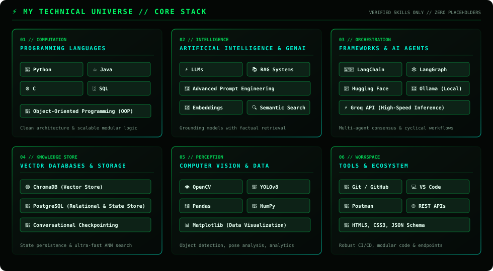
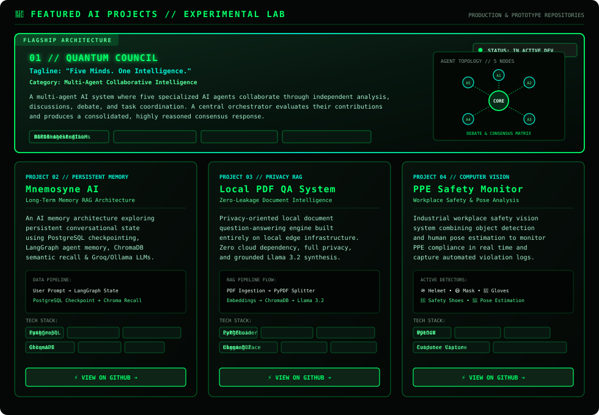

<!-- ================================================================= -->
<!-- SECTION A: HERO BANNER & MATRIX ASCII IDENTITY                     -->
<!-- ================================================================= -->

  

<!-- Status Tagline -->

  
  
  

  <b>Aspiring AI Engineer</b> &nbsp;|&nbsp; 
  <b>Generative AI Developer</b> &nbsp;|&nbsp; 
  <b>AI &amp; Data Science Engineering Student</b>

  <i>"Building practical intelligent systems that reason, collaborate, and perceive."</i>

 

<!-- Quick Social Badges -->

  
  &nbsp;
  
  &nbsp;
  

 

---

 

<!-- ================================================================= -->
<!-- SECTION B: ABOUT ME — TERMINAL INTERFACE                          -->
<!-- ================================================================= -->

### 🖥️ &nbsp; System Session // About Me

  

 

---

 

<!-- ================================================================= -->
<!-- SECTION C: MY TECHNICAL UNIVERSE                                   -->
<!-- ================================================================= -->

### ⚡ &nbsp; Technical Universe // Verified Stack

> [!NOTE]
> *Curated technology spectrum representing practical engineering competence in core AI pipelines, local LLM orchestration, and computer vision systems.*

  

 

---

 

<!-- ================================================================= -->
<!-- SECTION D: FEATURED PROJECTS // THE AI LAB                         -->
<!-- ================================================================= -->

### 🧬 &nbsp; Featured Projects // Experimental AI Laboratory

  

 

#### Detailed Repository Architecture:

<table>
  <thead>
    <tr>
      <th width="30%">Project</th>
      <th width="50%">Architecture &amp; Core Innovation</th>
      <th width="20%">Access</th>
    </tr>
  </thead>
  <tbody>
    <tr>
      <td>
        <b>01 // Quantum Council</b> 
        Flagship Architecture 
        <code>Multi-Agent Consensus</code>
      </td>
      <td>
        • <b>Tagline:</b> <i>"Five Minds. One Intelligence."</i> 
        • <b>Overview:</b> A collaborative multi-agent architecture where five specialized AI agents debate, analyze, and coordinate tasks independently before a central orchestrator consolidates a reasoned consensus. 
        • <b>Core Concepts:</b> Multi-Agent AI, LLM Orchestration, Agent Debate, Local/Cloud Hybrid Models. 
        • <b>Status:</b> <code>In Active Development (Research Phase)</code>
      </td>
      <td>
        
      </td>
    </tr>
    <tr>
      <td>
        <b>02 // Mnemosyne AI</b> 
        Persistent Memory RAG 
        <code>Stateful Checkpointing</code>
      </td>
      <td>
        • <b>Overview:</b> Long-term conversational memory exploration utilizing PostgreSQL state checkpointing, LangGraph cyclic workflow graphs, and ChromaDB semantic recall. 
        • <b>Stack:</b> <code>Python</code>, <code>LangGraph</code>, <code>PostgreSQL</code>, <code>ChromaDB</code>, <code>Groq API</code>, <code>Ollama</code>, <code>Hugging Face</code>.
      </td>
      <td>
        
      </td>
    </tr>
    <tr>
      <td>
        <b>03 // Local PDF QA System</b> 
        Privacy RAG Engine 
        <code>Zero-Cloud Document QA</code>
      </td>
      <td>
        • <b>Workflow:</b> PDF ingestion ➔ PyPDF splitting ➔ Hugging Face embeddings ➔ ChromaDB vector store ➔ Similarity retrieval ➔ Local Llama 3.2 synthesis via Ollama. 
        • <b>Stack:</b> <code>Python</code>, <code>LangChain</code>, <code>PyPDFLoader</code>, <code>Hugging Face</code>, <code>ChromaDB</code>, <code>Ollama</code>, <code>Llama 3.2</code>.
      </td>
      <td>
        
      </td>
    </tr>
    <tr>
      <td>
        <b>04 // PPE Safety Monitor</b> 
        Vision Intelligence 
        <code>Workplace Compliance</code>
      </td>
      <td>
        • <b>Features:</b> Real-time helmet, mask, gloves, and safety shoe detection paired with worker pose estimation and automated infraction snapshot evidence capture. 
        • <b>Stack:</b> <code>Python</code>, <code>YOLOv8</code>, <code>OpenCV</code>, <code>Computer Vision</code>.
      </td>
      <td>
        
      </td>
    </tr>
  </tbody>
</table>

---

### ⚡ GitHub Overview

  
  

---

 

> *"Simplicity is prerequisite for reliability."* — Edsger W. Dijkstra
